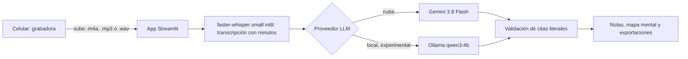

# Minuta

> Proyecto final de la Diplomatura de Especialización en Ciencia de Datos de Q-Lab PUCP. Prototipo que corre en local; la URL pública está pendiente.

---

## 1. One-liner

Minuta convierte las clases que los universitarios graban con su celular en notas y un mapa mental donde cada idea lleva su minuto y su cita literal, desde S/ 9.90 al mes.

---

## 2. Founder

**Rodrigo Norabuena.** Asistente de investigación con experiencia en analítica de datos, flujos ETL, bases de datos y dashboards en una escuela de negocios de Lima, y estudiante de la Diplomatura de Especialización en Ciencia de Datos de Q-Lab PUCP.

- **Foto:** pendiente (`docs/capturas/founder.jpg`).
- **Por qué este problema:** en mi trabajo documento reuniones de proyectos de investigación, ponencias académicas y entrevistas, donde el español se mezcla con términos en inglés.
- **Cómo cubro cada frente con agentes de IA:**
  - producto: Claude Code (investigación, plan y auditorías);
  - ingeniería y QA: un enjambre de Gemini 3.8 Flash en Google Antigravity;
  - diseño: el rol de diseño UI/UX del mismo enjambre;
  - ventas: todavía no hay un flujo de ventas; las conversaciones con usuarios fueron el primer contacto.

---

## 3. Problema

**Quién lo sufre:** universitarios que graban sus clases con el celular para repasarlas. También quienes graban charlas, reuniones de trabajo o entrevistas.

**Cuánto les cuesta:**
- Las 2 personas con las que conversé vuelven a escuchar grabaciones completas de 1 a 2 horas: "Si dura 1-2 horas lo voy a escuchar nuevamente" (conversación 01) y "usualmente hago grabaciones de 2 horas de mis clases y las escucho completas" (conversación 02).
- Una persona calcula más de 5 horas para transcribir una reunión (conversación 01): "Podría tardar más de 5 horas solo para una reunión".
- Cuando hay prisa, se busca a mano el momento: "si estoy apurada voy momento exacto donde quiero escuchar nuevamente la explicación" (conversación 02).

**Cómo lo resuelven hoy:**
- Reescuchan la grabación completa.
- Usan NotebookLM, que según la conversación 02 "no siempre recoge con precisión algunos términos técnicos o palabras en inglés".
- Usan Zoom AI Notes y luego ChatGPT o Gemini para resumir (conversación 01). La referencia de esa persona es la prueba gratuita de 3 usos de Zoom, que coincide con la cuota del plan Básico (ver la competencia en la sección 7).
- Existen grabadoras con IA como Plaud, pero ninguna de las 2 personas compraría una: "No pagaría porque es una inversión fuerte para algo que puedo hacer con mi celular" (conversación 02).

**Términos en inglés dentro del español:** en nuestra medición (H1), Whisper `small` acertó 43 de 50 términos (86 %) en 25 frases grabadas con el celular. Confundió *arXiv* con "RCIP" y *editorial board* con "digital board". El glosario no mejoró el resultado (+0 pts). Minuta no promete corregir esos términos: las citas son literales, así que el error queda a la vista y se puede escuchar con ▶.

**La nube:** una persona no subiría grabaciones con información personal o privada (conversación 02). La otra no sube grabaciones a la nube porque son archivos pesados (conversación 01).

**Evidencia de usuarios (n = 2):** 2 de las 3 conversaciones requeridas, en `docs/research/`: [conversación 01](docs/research/conversacion-01.md) y [conversación 02](docs/research/conversacion-02.md).
- Ambas personas graban con su celular entre 1 y 3 veces por semana, reescuchan grabaciones completas de 1 a 2 horas y no comprarían un Plaud.
- Límites: n = 2, respuestas por escrito y contactos del founder.
- La tercera conversación está pendiente.

---

## 4. Solución e insight

**Insight:** No buscan otro resumen: quieren volver al minuto exacto de una explicación sin reescuchar 2 horas (conversación 02).

**Qué construí:**
- **Captura con el celular:** grabas con la grabadora del teléfono y subes el archivo (`.m4a`, `.mp3` o `.wav`) desde el navegador.
- **Un formato por tipo de grabación:**
  - **Ponencia / Clase / Charla:** notas de clase (resumen, ideas clave y preguntas) y un mapa mental con markmap.js.
  - **Reunión:** notas de reunión (resumen, temas, acuerdos y tareas con responsable y fecha límite).
  - **Entrevista:** esquema por temas, con minuto y cita en cada punto, y un libro de códigos.
  - **En todas:** la transcripción completa con marcas `[mm:ss]`.
- **Cada punto con su cita:** cada idea, tarea y nodo lleva una cita comprobada como texto literal de la transcripción, y el minuto del inicio del segmento que contiene la cita. Las citas que no aparecen en la transcripción se descartan.
- **▶ [mm:ss]:** salta a ese minuto en el audio subido en la sesión.
- **Mapa mental:** se le pide al modelo un árbol de 2 a 4 niveles y de 4 a 8 ramas.
- **Exportación:** Markdown, Word, Excel, la transcripción en `.txt` y el mapa mental en HTML.
- **Modo local (experimental):** faster-whisper y Ollama (`qwen3:4b`) en la laptop. El audio y el texto no salen de ella, pero markmap se carga desde un CDN y los modelos se descargan la primera vez.

---

## 5. Why now

1. **Whisper ya corre en CPU:** faster-whisper `small` int8 con VAD transcribe una hora de audio en unos 8 minutos (RTF 0.1336, 404 MB de RAM), medido en una computadora de escritorio con AMD Ryzen 5 5600G y 32 GB de RAM, sin GPU (H2, [docs/resultados.md](docs/resultados.md)).
2. **Los LLM devuelven salida estructurada a bajo costo:** con Gemini 3.8 Flash, una hora de audio cuesta un estimado de S/ 0.093 con los precios de 2026 y S/ 0.167 con los de 2027 (sección 7).

---

## 6. Demo

- **URL pública:** pendiente. Por ahora corre en local.
- **Video de respaldo (60–90 s):** pendiente (enlace por agregar).

### Cómo correrlo

Con Python 3.12:

```powershell
pip install -r requirements.txt
# copia .env.example como .env y completa GEMINI_API_KEY
streamlit run app/streamlit_app.py
```

### Flujo en la app

1. El modo demo está apagado por defecto. El interruptor de arriba muestra un ejemplo precalculado.
2. Elige la plantilla y el modo de análisis "Solo LLM", que es el predeterminado. El detector mmBERT está en desarrollo y no está activo.
3. Sube un audio grabado con el celular.
4. Revisa las notas y la cita de cada punto, y pulsa ▶ [mm:ss] para escuchar ese momento.
5. Exporta el resultado.

### Arquitectura



Más detalle en [docs/arquitectura.md](docs/arquitectura.md).

### Modelos y por qué

- **faster-whisper `small` int8:** transcribe una hora en unos 8 minutos en CPU, sin GPU (H2).
- **Gemini 3.8 Flash (nube):** devuelve JSON que se valida con Pydantic, a un costo estimado de S/ 0.09 a S/ 0.17 por hora de audio.
- **Ollama `qwen3:4b` (local, experimental):** para que el audio y el texto no salgan de la laptop. Devolvió JSON válido en 2 de 2 bloques, con 64 s por bloque (H6, no concluyente).
- **mmBERT-small:** en desarrollo, no activo en el producto (H4 pendiente).

### Capturas

Pendientes, en `docs/capturas/`:

1. `docs/capturas/01-subida.png` (pendiente): subida del audio desde el celular.
2. `docs/capturas/02-notas.png` (pendiente): notas con cita y ▶ [mm:ss].
3. `docs/capturas/03-mapa.png` (pendiente): mapa mental y exportación.

---

## 7. Modelo de negocio

**Quién paga:** el universitario que graba sus clases (plan Estudiante) y quien además graba reuniones, charlas o entrevistas (plan Pro).

### Planes

Los precios están por debajo de lo que las 2 personas dijeron estar dispuestas a pagar (S/ 15–25 y S/ 30–40 con uso ilimitado).

| Plan | Precio | Incluye | Costo con uso completo (2026 / 2027) | Margen de contribución (2026 / 2027) |
|---|---|---|---|---|
| Gratis | S/ 0 | 2 h al mes | S/ 0.19 / S/ 0.33 | — (costo de adquisición) |
| Estudiante | S/ 9.90 al mes | 15 h al mes | S/ 1.39 / S/ 2.50 | S/ 8.51 (86.0 %) / S/ 7.40 (74.7 %) |
| Pro | S/ 24.90 al mes | 40 h al mes, modo local y exportaciones | S/ 3.70 / S/ 6.68 | S/ 21.20 (85.1 %) / S/ 18.22 (73.2 %) |

### Costo por hora de audio

| Precios de Gemini 3.8 Flash | US$ por hora | S/ por hora |
|---|---|---|
| Hasta el 31/12/2026 | 0.0271 | 0.093 |
| Desde el 01/01/2027 | 0.0488 | 0.167 |

- **Precio de Gemini 3.8 Flash** ([aistudio.google.com/docs/pricing](https://aistudio.google.com/docs/pricing), leído el 10/11/2026), por millón de tokens, con la salida que incluye el razonamiento: US$0.75 de entrada y US$3.75 de salida hasta el 31/12/2026, y US$1.50 y US$7.50 desde el 01/01/2027.
- **Tokens por hora (estimados, no medidos):** 14,000 de entrada y 3,000 de salida.
- **Whisper en un servidor (supuesto sin fuente):** US$0.00533 por hora de audio, con 2 vCPU a US$0.040 por hora durante 8 minutos.
- **Tipo de cambio:** 3.418 S/ por US$, venta del sistema bancario SBS al 09/11/2026 ([BCRP, serie PD04640PD](https://estadisticas.bcrp.gob.pe/estadisticas/series/api/PD04640PD/json/2026-11-01/2026-11-10)).
- El cálculo completo está en [docs/resultados.md](docs/resultados.md), sección 4.

### Competencia

| Alternativa | Qué ofrece y cuánto cuesta | Fuente (leída el 10/11/2026) |
|---|---|---|
| Plaud | Grabadoras NotePin S a US$179 y Note Pro a US$189, marcadas "Agotado" en la sección de comparación. Plan Starter gratis con 300 min al mes, incluido con el aparato; Pro a MXN 167 al mes y Unlimited a MXN 400 al mes, con pago anual. La página mezcla USD y MXN. | [latam.plaud.ai](https://latam.plaud.ai/pages/shop-plaud) |
| Zoom | Plan Básico sin precio indicado, con 3 resúmenes de reuniones y 3 usos de notas con IA al mes. Pro a US$16.99 por usuario al mes con pago mensual, o US$14.16 con pago anual. | [zoom.us/es/pricing](https://zoom.us/es/pricing) |
| NotebookLM | No se citan precios ni límites: no se consultó una fuente oficial. | — |
| No hacer nada | Reescuchar la grabación completa, de 1 a 2 horas. | Conversaciones 01 y 02 |

### Qué sigue

1. La tercera conversación con usuarios.
2. Publicar la URL y probarla desde el celular (H3).
3. Reemplazar los tokens estimados por los medidos.
4. Evaluar las tareas (H8) y el mapa mental (H9) con grabaciones reales.

---

## 8. Herramientas del curso

| Herramienta | Dónde está | Por qué esta |
|---|---|---|
| Voz a texto con Whisper (sesión 13) | `minuta/transcribir.py` | faster-whisper `small` int8 transcribe una hora en unos 8 minutos en CPU (H2), sin GPU, y hace posible el modo local. |
| LLMs con salidas estructuradas (sesión 08) | `minuta/esquemas.py`, `minuta/estructurar.py` y `minuta/proveedores.py` | El modelo devuelve JSON con un esquema Pydantic, así que cada punto trae su cita y su minuto, y la app descarta las citas que no están en la transcripción. |

El afinamiento de mmBERT (sesión 09, en `entrenamiento/` y `minuta/detector.py`) está en desarrollo, no activo en el producto (H4 pendiente).

---

## 9. Qué hizo el agente

- **Claude Code (Claude Opus 5.5):** la investigación, la planificación, las auditorías y las correcciones del 10/11/2026 en `minuta/`, `app/`, `evaluacion/`, la documentación y las dependencias.
- **Un enjambre de Gemini 3.8 Flash en Google Antigravity** construyó la mayor parte del código, con 5 roles:
  - **jefe de proyecto:** coordinación, Git y bitácora;
  - **científico de datos:** datos sintéticos (`entrenamiento/datos/`), oráculos de evaluación (`evaluacion/`) y [docs/resultados.md](docs/resultados.md);
  - **ingeniero de ML:** transcripción (`minuta/transcribir.py` y `minuta/compat.py`), esquemas y estructuración (`minuta/esquemas.py` y `minuta/estructurar.py`) y el afinamiento de mmBERT (`entrenamiento/`);
  - **diseñador UI/UX:** la app (`app/streamlit_app.py`), el mapa mental (`minuta/mapa_html.py`) y las exportaciones (`minuta/exportar.py`);
  - **ingeniero de QA:** `scripts/verificar.py` y las pruebas de extremo a extremo (`tests/e2e/`).
- **El founder:** las decisiones de producto y las conversaciones con usuarios.
- La coautoría con IA se declara en cada commit (`Co-Authored-By`).

### Seguridad y privacidad

- `python scripts/verificar.py` revisa que no haya claves en el historial (`git log -p`), que `.env` no esté versionado y que no haya audio en el índice, y corre la suite de pruebas (`pytest -q`).
- Ningún audio se versiona: las grabaciones de evaluación quedan en `data/privado/`, que está en `.gitignore`.
- La demo precalculada (`data/demo/`) y los fixtures (`data/fixtures/`) son texto ficticio.

### Desarrollo

```powershell
pip install -r requirements-dev.txt
pytest -q
```

Licencia: [MIT](LICENSE).
