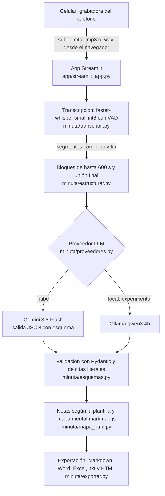

# Arquitectura de Minuta

Flujo principal, de la grabación en el celular a las notas exportadas.

## Componentes

| Etapa | Archivo | Qué hace |
|---|---|---|
| Interfaz | `app/streamlit_app.py` | Sube el audio, elige la plantilla y el proveedor, muestra las notas y el reproductor ▶ [mm:ss]. |
| Transcripción | `minuta/transcribir.py` | faster-whisper `small` int8 con VAD, en CPU. |
| Estructuración | `minuta/estructurar.py` | Divide la transcripción en bloques de hasta 600 s, pide al LLM las notas de cada bloque y las une. |
| Proveedores | `minuta/proveedores.py` | Gemini 3.8 Flash por API u Ollama `qwen3:4b` en la laptop. |
| Contrato | `minuta/esquemas.py` | Esquemas Pydantic por plantilla. Descarta las citas que no aparecen en la transcripción y fija el minuto en el inicio del segmento que contiene la cita. |
| Mapa mental | `minuta/mapa_html.py` | Dibuja el árbol con markmap.js, cargado desde un CDN con versión fija. |
| Exportación | `minuta/exportar.py` | Markdown, Word, Excel y HTML del mapa. |

## Qué sale de la laptop en cada modo

- **Gemini (nube):** el texto de la transcripción se envía a la API de Gemini. El audio se transcribe en la máquina donde corre la app.
- **Ollama (local, experimental):** el audio y el texto no salen de la laptop. Aun así, markmap se carga desde un CDN y los modelos se descargan la primera vez.
- **▶ [mm:ss]:** solo reproduce un audio subido en la sesión. En el modo demo, el minuto se muestra como texto.

## Fuera del producto por ahora

- **Detector mmBERT** (`minuta/detector.py` y `entrenamiento/`): en desarrollo, no activo en el producto (H4 pendiente).
- **URL pública:** pendiente (H3).
