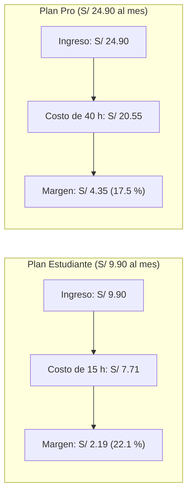

# Resultados de las hipótesis y costo por hora de audio

- **Startup:** Minuta convierte las clases que los universitarios graban con su celular en notas y un mapa mental donde cada idea lleva su minuto y su cita literal.
- **Método:** hipótesis pre-registradas (H1 a H9), con umbrales fijados antes de ver los datos y oráculos que se corren desde la consola.
- **Fecha de corte:** 10 de noviembre de 2026.
- **Reproducibilidad:**
  - La app llama a los LLM con temperatura 0 (`minuta/proveedores.py`). La generación de datos sintéticos con Gemini usa temperatura 0.4.
  - El generador de sintéticos sin API (`generar_conversacion_sintetica_dry_run`) usa `seed=42`, pero lo mezcla con `hash(tipo)`, y el hash de un texto cambia en cada proceso de Python. Por eso esa generación no es reproducible entre procesos.

---

## 1. Resumen

Minuta responde a un problema que las 2 personas entrevistadas describieron: reescuchan grabaciones completas de 1 a 2 horas para encontrar una explicación. Hoy existen grabadoras con IA como Plaud (NotePin S a US$179 y Note Pro a US$189, marcadas "Agotado" en [latam.plaud.ai](https://latam.plaud.ai/pages/shop-plaud) el 10/11/2026) y herramientas de software como NotebookLM y Zoom AI Notes, que las personas entrevistadas ya usan.

Este documento reúne lo que se midió, lo que falta medir y el costo por hora de audio, medido con una llamada real y extrapolado a 1 hora.

| Estado | Hipótesis |
|---|---|
| Confirmada | H2 (velocidad de Whisper en clip y en reunión real) y H7 (problema real, con n = 2) |
| Falsada | H1 (glosario de términos en inglés) y H6 (Ollama local en CPU: timeout > 600 s) |
| Pendiente | H3, H4, H5a, H5b, H8 y H9 |

---

## 2. Matriz de hipótesis

| H# | Hipótesis | Confirmada si | Falsada si | Resultado | Veredicto | Oráculo |
|---|---|---|---|---|---|---|
| **H1** | El glosario ES-EN en la transcripción mejora los términos técnicos en inglés | Recall ≥ 85 % y ≥ +15 pts sobre la línea base (25 frases) | Mejora < 10 pts o recall < 70 % | Línea base: 86 % (43 de 50). Con el glosario del producto (`hotwords`): 86 % (43 de 50). Mejora: **+0 pts**. En un clip continuo de 5 min: 90 % sin glosario y 88 % con `hotwords`. | **FALSADA** | `python -m evaluacion.terminos --audios data/privado/frases/ --modelo small --tipo-glosario producto` |
| **H2** | `small` int8 con VAD procesa 1 hora de audio en CPU | ≤ 20 min por hora (RTF ≤ 0.33) | > 30 min por hora | Clip 300 s: RTF **0.1336** (8.0 min/h), 404.1 MB RAM. Reunión real (64.42 min, 2,396 segmentos): **12.68 min**, RTF **0.1969**. | **CONFIRMADA** | Fuente: reunión de trabajo real (no publicada), 64 min, procesada solo en local (`evaluacion.privado`); y clip de 300 s (`evaluacion.velocidad`) |
| **H3** | La app cabe en Streamlit Community Cloud | < 2.7 GB de RAM y clip de 60 s en ≤ 60 s | Falla por memoria o > 120 s | Sin desplegar. Whisper `base` usó 225.9 MB de RAM en local. | **PENDIENTE** | Despliegue de prueba y clip de 60 s desde el celular |
| **H4** | mmBERT-small afinado con sintéticos clasifica segmentos y generaliza | F1 macro ≥ 0.70 y recall de `tarea` ≥ 0.80 | F1 macro < 0.55 o recall de `tarea` < 0.65 | Hay 1,351 segmentos sintéticos (98.45 % únicos). El modelo no está entrenado ni evaluado. | **PENDIENTE** | `python -m evaluacion.detector --modelo <modelo> --etiquetas data/eval/reunion_etiquetada.csv` |
| **H5a** | El detector ahorra tokens y tiempo en reuniones | −60 % de tokens, −40 % de tiempo y caída del recall de tareas ≤ 5 pts | Ahorro < 40 % o caída > 10 pts | Sin medición: el detector no está entrenado. | **PENDIENTE** | `python -m evaluacion.eficiencia --entrada <reunion.json> --modos solo_llm,detector` |
| **H5b** | El detector ahorra tokens en ponencias | −25 % de tokens y caída de cobertura del mapa ≤ 10 % | Ahorro < 10 % | Sin medición: el detector no está entrenado. | **PENDIENTE** | Ídem, con `<ponencia.json>` |
| **H6** | Ollama `qwen3:4b` devuelve JSON válido, incluido el mapa | ≥ 95 % válido y < 60 s por bloque | < 85 % o > 120 s por bloque | En reunión real de 64 min (6 bloques), el bloque 1 no respondió en 600 s (timeout, 0 de 1 válidos, 0.0 % válido, latencia > 120 s). Limitación: transcribe en tu PC; la estructuración local necesita GPU. | **FALSADA** | Fuente: reunión de trabajo real (no publicada), 64 min, procesada solo en local (`evaluacion.privado`); fixtures en `evaluacion.validez_json` |
| **H7** | El problema es real para quien graba con el celular | ≥ 2 de 3 graban ≥ 2 veces al mes, dedican ≥ 30 min por grabación y no pagarían un aparato como Plaud | 0 o 1 de 3 | 2 de 2 cumplen los 3 criterios, con 2 de las 3 conversaciones requeridas | **CONFIRMADA** (n = 2) | Notas en `docs/research/conversacion-01.md` y `docs/research/conversacion-02.md` |
| **H8** | Las tareas son confiables | Precisión ≥ 0.80, recall ≥ 0.70 y 100 % de citas literales | Precisión < 0.65 o alguna cita no literal | Falta la referencia etiquetada a mano (no hay lista de referencia de la reunión real). | **PENDIENTE** | `python -m evaluacion.todos --pred <salida.json> --ref data/eval/todos_manual.csv` |
| **H9** | El mapa mental es verificable y útil (solo plantilla Clase) | ≥ 90 % de nodos con cita literal, 2–4 niveles, 4–8 ramas en 1 h y mediana de utilidad ≥ 4/5 | < 75 % con cita o mediana < 3/5 | Falta una grabación real completa. El fixture de prueba tiene 3 ramas. | **PENDIENTE** | `python -m evaluacion.mapa --pred <salida.json> --transcripcion <transcripcion.json>` |

---

## 3. Detalle por hipótesis

### 3.1 H1: glosario de términos en inglés (FALSADA)

Se evaluó si un glosario técnico (*hotwords* en Whisper) mejoraba la transcripción de términos en inglés dentro del español (*journal*, *paper*, *grant*, *peer review*, *trade-off*).

Se usaron 25 frases grabadas con el celular (`data/privado/frases/`), con 50 términos esperados:
- **Línea base (sin glosario, `small` int8):** 43 de 50, **recall 86 %**.
- **Con el glosario del producto (`hotwords`):** 43 de 50, **recall 86 %** (**+0 pts**).
- **Clip continuo de 5 minutos (300 s):** 45 de 50 sin glosario (90 %), 45 de 50 con `initial_prompt` (90 %) y 44 de 50 con `hotwords` (88 %).

**Desglose por glosario.** De los 50 términos evaluados, 29 están en el glosario del producto. Ese glosario se versionó un día después del guion de frases, así que esos 29 términos pueden favorecerlo. Se reporta aparte:

| Términos | Sin glosario | Con glosario (`hotwords`) | Cambio |
|---|---|---|---|
| Dentro del glosario (29) | 27 de 29 (93,1 %) | 28 de 29 (96,6 %) | +3,4 pts |
| Fuera del glosario (21) | 16 de 21 (76,2 %) | 15 de 21 (71,4 %) | −4,8 pts |

El glosario ayuda un poco con los términos que contiene y empeora los demás; el efecto neto es 0. Aun con la posible ventaja de los 29 términos, H1 queda falsada. El desglose sale de `python -m evaluacion.terminos` (sección "Desglose por glosario").

Los 7 errores de la línea base:
1. Frase 05: `arXiv` → "RCIP" (*"publicamos una versión preliminar como preprint en RCIP"*).
2. Frase 06: `grant` → "gran" (*"Postulamos a un gran internacional"*).
3. Frase 06: `principal investigator` → "principal investigador".
4. Frase 08: `coauthors` → "co-authors".
5. Frase 11: `editorial board` → "digital board" (*"quedamos a la espera de la digital board"*).
6. Frase 15: `ablation study` → "ablación y study" (*"durante el ablación y study"*).
7. Frase 17: `major revision` → "mayor revision".

**Limitación:** 29 de los 50 términos evaluados ya estaban en el glosario. Falta reportar el recall dentro y fuera del glosario.

**Decisión:** el glosario no mejora el reconocimiento cuando un término en inglés suena casi igual que una palabra en español (*grant* → "gran"). Minuta no promete corregir términos: el LLM no tiene esa instrucción y las citas deben ser literales, así que conservan lo que transcribió Whisper. El error queda a la vista en la cita y se puede escuchar con ▶.

---

### 3.2 H2: velocidad de faster-whisper (CONFIRMADA)

Se midió `faster-whisper 1.2.1` con int8 y VAD sobre 300 s de audio real concatenado, en una computadora de escritorio con AMD Ryzen 5 5600G y 32 GB de RAM, sin GPU:

| Modelo | Cuantización | Carga | Transcripción | RTF | Minutos por hora de audio | RAM | Palabras | Veredicto |
|---|---|---|---|---|---|---|---|---|
| `base` | int8 | 0.96 s | 15.09 s | 0.0503 | 3.0 | 225.9 MB | 483 | CONFIRMADA |
| **`small` (elegido)** | int8 | 1.36 s | 40.09 s | **0.1336** | **8.0** | **404.1 MB** | 485 | **CONFIRMADA** |
| `large-v3-turbo` | int8 | 3.69 s | 89.73 s | 0.2991 | 17.9 | 970.4 MB | 486 | CONFIRMADA |

El umbral pedía 1 hora de audio en ≤ 20 minutos (RTF ≤ 0.33). `small` tardó **8.0 minutos por hora** con 404 MB de RAM. El resultado vale para esa computadora; en una laptop más modesta el tiempo puede ser mayor.

**Medición con audio real largo (reunión de 64 min):**
Se procesó una reunión real completa de 64.42 min (2,396 segmentos) con `faster-whisper small int8` en la misma máquina local en CPU:
- Duración del audio: 64.42 min.
- Tiempo de transcripción: 12.68 min.
- RTF observado: **0.1969** (equivalente a 11.8 min por hora de audio).
- Veredicto: **CONFIRMADA** con audio real largo (RTF 0.1969 ≤ 0.33 y 12.68 min ≤ 20 min).

Fuente: reunión de trabajo real (no publicada), 64 min, procesada solo en local.

---

### 3.3 H5a y H5b: ahorro con el detector (PENDIENTE)

No hay medición. El detector mmBERT no está entrenado y la app usa "Solo LLM". La corrida con `--simulado` del arnés devuelve valores fijos de diseño (62.5 % y 27.0 % de ahorro de tokens), no mediciones, así que no se usan como evidencia.

---

### 3.4 H6: salida estructurada local con Ollama (FALSADA)

Se evaluó `qwen3:4b` en Ollama (`temperature=0.0`, `think=false`) en dos escenarios:
1. **Fixtures cortos:** 2 de 2 bloques válidos (100 %) con 64.09 s por bloque en promedio.
2. **Reunión real completa de 64 min (6 bloques):** en el bloque 1, `qwen3:4b` no respondió en 600 s (timeout configurado), con 0 de 1 bloques válidos (0.0 % de JSON válido) y latencia superior a los 120 s del umbral de falsación.

Fuente: reunión de trabajo real (no publicada), 64 min, procesada solo en local.

**Decisión y limitación declarada:** H6 queda **FALSADA** para estructuración en CPU. Siguiendo el plan pre-registrado y sin re-medir con 8b (que aumentaría la carga en CPU), se declara la limitación del modo local en CPU:
> *"transcribe en tu PC; la estructuración local necesita GPU"*

Whisper int8 resuelve la transcripción en local en CPU (H2 confirmada), mientras que la estructuración del mapa y notas requiere aceleración por GPU local o la API en la nube (Gemini Flash).

---

### 3.5 H7: problema real (CONFIRMADA, n = 2)

Hay notas de 2 de las 3 conversaciones requeridas (`docs/research/conversacion-01.md` y `docs/research/conversacion-02.md`).

| Criterio pre-registrado | Persona 1 (conversación 01) | Persona 2 (conversación 02) | ¿Se cumple? |
|---|---|---|---|
| Graba con el celular ≥ 2 veces al mes | "ahora es 1-3 veces por semana" | "Será unas 1 a 2 veces por semana" | Sí, en ambas |
| Dedica ≥ 30 min por grabación a repaso o apuntes | "Si dura 1-2 horas lo voy a escuchar nuevamente" | "usualmente hago grabaciones de 2 horas de mis clases y las escucho completas" | Sí, en ambas |
| No pagaría un aparato como Plaud | "prefiero pagar una suscripción que use a mi celular como grabadora" | "No pagaría porque es una inversión fuerte" | Sí, en ambas |

- **Veredicto:** CONFIRMADA (2 de 2 cumplen los 3 criterios).
- **Limitaciones:** n = 2, respuestas por escrito y contactos del founder. Falta la tercera conversación.
- **Con qué se comparan:** con software, no con un aparato. La persona 1 valoró la prueba gratuita de 3 usos de Zoom AI Notes. La persona 2 usa NotebookLM y escribió que "no siempre recoge con precisión algunos términos técnicos o palabras en inglés". También escribió: "si estoy apurada voy momento exacto donde quiero escuchar nuevamente la explicación".

---

### 3.6 H8 y H9: tareas y mapa mental (PENDIENTES)

- **H8 (tareas):** falta una reunión transcrita y etiquetada a mano. Las pruebas unitarias comprueban que el contrato descarta las citas que no aparecen en la transcripción.
- **H9 (mapa mental):** aplica solo a la plantilla **Ponencia / Clase / Charla**. El fixture de prueba tiene 3 ramas principales y el criterio pide 4 a 8 en 1 hora. Falta una grabación real completa y el formulario de utilidad.

---

## 4. Costo por hora de audio

### 4.1 Supuestos y precios

Los tokens se **midieron** con el `usageMetadata` de una llamada real del 10/11/2026. Se usó el fixture de la reunión actuada (`data/fixtures/transcripcion_reunion.json`, 346 s) con la plantilla Reunión y el razonamiento en nivel `low`. Respondió `gemini-3.6-flash`, el modelo de respaldo, que tiene el mismo precio que 3.8 Flash. La llamada tardó 27 s.

Medido: **1,844 tokens de entrada, 1,489 de salida y 0 de razonamiento.** La hora se extrapola linealmente: × 3600 / 346 = × 10.40.

| Dato | Valor | Tipo | Fuente o base |
|---|---|---|---|
| Tokens de entrada por hora de audio | 19,186 | extrapolado de una medición | 1,844 tokens en 346 s × 10.40 |
| Tokens de salida por hora de audio, con razonamiento | 15,492 | extrapolado de una medición | 1,489 tokens en 346 s × 10.40, con 0 de razonamiento |
| Whisper en un servidor | US$0.00533 por hora de audio | supuesto sin fuente | 2 vCPU a US$0.040 por hora durante 8 min (los 8 min vienen de H2) |
| Gemini 3.8 Flash, entrada, por 1M de tokens | US$0.75 hasta el 31/12/2026; US$1.50 desde el 01/01/2027 | oficial | [aistudio.google.com/docs/pricing](https://aistudio.google.com/docs/pricing), leído el 10/11/2026 |
| Gemini 3.8 Flash, salida (incluye razonamiento), por 1M de tokens | US$3.75 hasta el 31/12/2026; US$7.50 desde el 01/01/2027 | oficial | Ídem |
| Tipo de cambio | 3.418 S/ por US$ | oficial | SBS, venta del sistema bancario, 09/11/2026 (el 10/11 aún no estaba publicado): [BCRP, serie PD04640PD](https://estadisticas.bcrp.gob.pe/estadisticas/series/api/PD04640PD/json/2026-11-01/2026-11-10) |

**Por qué el razonamiento va en `low`.** Con el nivel por defecto (`medium`), la misma reunión gastó 4,030 tokens de razonamiento además de 1,853 de respuesta, y tardó 233 s. El razonamiento se cobra como salida, así que con `medium` el costo por hora casi se triplicaba. El nivel `low` es el mínimo que acepta `gemini-3.8-flash` ([aistudio.google.com/docs/thinking](https://aistudio.google.com/docs/thinking)).

**Límites de la medición:**
- Es una sola corrida, sobre una reunión actuada.
- La extrapolación a 1 hora supone que el costo crece en proporción a la duración.
- Whisper en un servidor sigue siendo un supuesto.

### 4.2 Cálculo

| Concepto | Precios 2026 | Precios 2027 |
|---|---|---|
| Entrada del LLM (19,186 tokens) | US$0.01439 | US$0.02878 |
| Salida del LLM (15,492 tokens) | US$0.05810 | US$0.11619 |
| Whisper en un servidor (supuesto) | US$0.00533 | US$0.00533 |
| **Total por hora de audio** | **US$0.0778** | **US$0.1503** |
| **Total en soles (× 3.418)** | **S/ 0.266** | **S/ 0.514** |

En el modo local, Whisper y el LLM corren en la laptop del usuario, y la empresa no paga esa hora.

---

## 5. Planes y margen de contribución

Los precios están por debajo de lo que las 2 personas dijeron estar dispuestas a pagar (S/ 15–25 y S/ 30–40 con uso ilimitado). El costo y el margen suponen que el usuario consume todas sus horas.

| Plan | Precio | Horas al mes | Costo (2026 / 2027) | Margen de contribución (2026 / 2027) | Por qué |
|---|---|---|---|---|---|
| **Gratis** | S/ 0 | 2 | S/ 0.53 / S/ 1.03 | — (costo de adquisición) | La persona 1 valoró la prueba gratuita de 3 usos de Zoom. |
| **Estudiante** | S/ 9.90 al mes | 15 | S/ 3.99 / S/ 7.71 | S/ 5.91 (59.7 %) / S/ 2.19 (22.1 %) | Para universitarios que graban 1 a 2 veces por semana. |
| **Pro** | S/ 24.90 al mes | 40, con modo local y exportaciones | S/ 10.64 / S/ 20.55 | S/ 14.26 (57.3 %) / S/ 4.35 (17.5 %) | Dentro del rango de S/ 15–25 de la persona 2. |

Con todas las horas usadas, el margen es de casi 60 % con los precios de 2026 y baja a cerca de 20 % con los de 2027, cuando Google duplica el precio. Dos palancas para bajar el costo, todavía sin medir:
- el detector mmBERT, que filtraría el relleno antes del LLM (H5a y H5b);
- un modelo Flash-Lite.

---

## 6. Competencia

Precios leídos el 10/11/2026 en las páginas oficiales:

| Alternativa | Qué ofrece y cuánto cuesta | Fuente |
|---|---|---|
| Plaud | Grabadoras NotePin S a US$179 y Note Pro a US$189, marcadas "Agotado" en la sección de comparación. Plan Starter gratis con 300 min al mes, incluido con el aparato; Pro a MXN 167 al mes y Unlimited a MXN 400 al mes, con pago anual. La página mezcla USD y MXN. | [latam.plaud.ai/pages/shop-plaud](https://latam.plaud.ai/pages/shop-plaud) |
| Zoom | Plan Básico sin precio indicado, con 3 resúmenes de reuniones y 3 usos de notas con IA al mes. Pro a US$16.99 por usuario al mes con pago mensual, o US$14.16 con pago anual. | [zoom.us/es/pricing](https://zoom.us/es/pricing) |
| NotebookLM | No se citan precios ni límites: no se consultó una fuente oficial. | — |
| No hacer nada | Reescuchar la grabación completa, de 1 a 2 horas. | Conversaciones 01 y 02 |

Los "3 usos" de la persona 1 coinciden con la cuota del plan Básico de Zoom.

**Lo que ofrece Minuta:** usa el celular que ya se tiene, cobra en soles, da un formato por tipo de grabación (notas de clase con mapa mental, notas de reunión o esquema por temas) y pone en cada punto una cita comprobada como texto literal de la transcripción, con el minuto del inicio del segmento que la contiene.

---

## 7. Margen de contribución por plan (precios de 2027)

---

## 8. Conclusiones para el pitch

1. **El celular basta:** las 2 personas graban con su celular y no comprarían un aparato como Plaud (US$179–189).
2. **El glosario no resolvió los términos en inglés (H1 falsada):** Whisper acertó 43 de 50 términos (86 %) con o sin glosario. Minuta no promete corregirlos; la cita literal deja el error a la vista.
3. **Cada punto con su cita:** la persona 2 busca a mano el minuto de una explicación. En Minuta, cada punto lleva una cita comprobada como texto literal de la transcripción y el inicio del segmento que contiene la cita.
4. **El margen es positivo pero estrecho:** una hora de audio cuesta S/ 0.27 con los precios de 2026 y S/ 0.51 con los de 2027, medido y extrapolado. Con todas las horas usadas, el margen es de casi 60 % hoy y de cerca de 20 % en 2027. Bajar el costo por hora es la prioridad de negocio.
