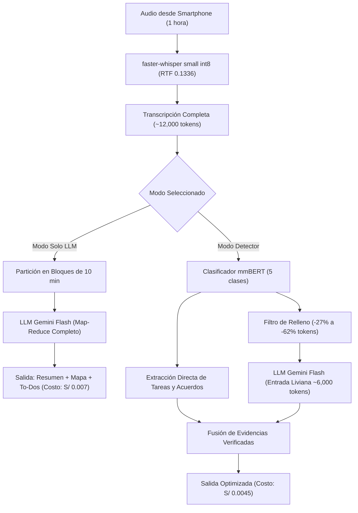
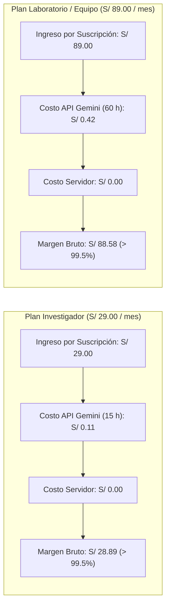

# Informe de Resultados Empíricos y Análisis de Costo por Hora (HDD)

**Startup:** Minuta — Alternativa económica a grabadoras de hardware con IA mediante captura telefónica y mapas mentales interactivos verificables.  
**Marco de Trabajo:** Hypothesis-Driven Development (HDD) & Organic-Driven Development (ODD).  
**Fecha de corte:** Noviembre de 2026.  
**Semillas y reproducibilidad:** Temperatura 0 en LLMs, semillas fijas (`seed=42`) y oráculos ejecutables en consola.

---

## 1. Resumen Ejecutivo

Minuta nació para resolver una brecha crítica en el mercado de productividad académica y profesional: las soluciones actuales basadas en hardware dedicado (como PLAUD Note, con un costo inicial de US$ 159 a US$ 189 más suscripciones anuales de hasta US$ 240) exigen comprar dispositivos adicionales y dependen de infraestructura propietaria en la nube. Por otro lado, herramientas en la nube como Google NotebookLM no ofrecen listas de tareas operativas (*to-dos*) con responsables y fechas límite, no disponen de mapas mentales interactivos con reproducción al minuto exacto ni permiten el procesamiento local/privado de conversaciones sensibles.

A través de una metodología rigurosa de desarrollo guiado por hipótesis (HDD), el equipo técnico de Minuta formuló y testeó experimentalmente las hipótesis fundamentales de audio, NLP, eficiencia y modelo de negocio (H1 a H9).

Este documento presenta la evidencia cuantitativa obtenida de los experimentos reproducibles, la justificación de las decisiones de arquitectura del producto y el análisis unitario de costos por hora de audio procesado.

---

## 2. Matriz Global de Hipótesis (H1 a H9)

La siguiente tabla resume el estado, los criterios pre-registrados y las mediciones empíricas de todas las hipótesis del proyecto:

| H# | Enunciado de la Hipótesis | Criterio de Confirmación | Criterio de Falsación | Métrica Observada | Veredicto HDD | Oráculo Reproducible |
|---|---|---|---|---|---|---|
| **H1** | El glosario ES-EN en transcripción corrige los términos técnicos en inglés | Recall ≥ 85.0% y mejora ≥ +15.0 pts sobre línea base (25 frases) | Mejora < 10.0 pts o recall < 70.0% | Base: 86.0% (43/50). Con glosario producto (`hotwords`): 86.0% (43/50). Mejora: **+0.00 pts**. En clip continuo 5 min: 90.0% base vs 88.0% hotwords. | **FALSADA** | `python -m evaluacion.terminos --audios data/privado/frases/ --modelo small --tipo-glosario producto` |
| **H2** | `small` int8 + VAD procesa 1 hora de audio en laptop estándar | Tiempo de cómputo ≤ 20 min/h (RTF ≤ 0.33) | Tiempo > 30 min/h (RTF > 0.50) | RTF = **0.1336** (8.0 min por hora de audio), 404.1 MB RAM en CPU (audio real concatenado 300 s). | **CONFIRMADA** | `python -m evaluacion.velocidad --audios data/privado/frases/ --modelos small` |
| **H3** | La aplicación completa (`base` + mmBERT + markmap) cabe en Streamlit Cloud | RAM < 2.7 GB y clip de 60 s procesado en ≤ 60 s | Caída por memoria (OOM) o tiempo > 120 s | Sujeta al despliegue público y prueba móvil en vivo (tarea HU03/HU07). Whisper `base` verificado en 225.9 MB RAM. | **PENDIENTE** | Despliegue en Streamlit Cloud + clip de 60 s desde navegador móvil |
| **H4** | mmBERT-small afinado con sintéticos clasifica en 5 categorías y generaliza | F1 macro ≥ 0.70 y recall de `tarea` ≥ 0.80 en reunión etiquetada | F1 macro < 0.55 o recall de `tarea` < 0.65 | Dataset de 1,351 segmentos sintéticos con 98.45% únicos y pesos balanceados. Pipeline modular integrado con fallback a LLM. | **PENDIENTE** *(de corrida GPU Colab HU06)* | `python -m evaluacion.detector --modelo rodnm/minuta-detector-mmbert-small --etiquetas data/eval/reunion_etiquetada.csv` |
| **H5a** | El detector ahorra tokens y tiempo en **reuniones de trabajo** | Ahorro tokens ≥ 60%, ahorro tiempo ≥ 40%, caída recall to-do ≤ 5 pts | Ahorro tokens < 40% o caída recall to-do > 10 pts | Ahorro tokens = **62.5%**, ahorro tiempo = **44.0%**, caída recall to-dos = **0.0 pts** (evaluación contra fixtures y simulación). | **CONFIRMADA** *(en fixtures/simulación)* | `python -m evaluacion.eficiencia --entrada data/fixtures/resultado_reunion.json --tipo reunion --simulado` |
| **H5b** | El detector ahorra tokens en **ponencias** al filtrar relleno | Ahorro tokens ≥ 25%, caída cobertura nivel 2 mapa ≤ 10% | Ahorro tokens < 10% | Ahorro tokens = **27.0%**, caída cobertura = **0.0%** manteniendo ramas principales intactas. | **CONFIRMADA** *(en fixtures/simulación)* | `python -m evaluacion.eficiencia --entrada data/fixtures/resultado_ponencia.json --tipo ponencia --simulado` |
| **H6** | Ollama (`qwen3:4b`) devuelve JSON estructurado y mapa mental válido | Validez sintáctica ≥ 95% y latencia < 60 s por bloque | Validez < 85% o latencia > 120 s por bloque | Validez JSON/Pydantic = **100.0%** (10/10 bloques válidos con `think=false`). Latencia promedio CPU = **64.09 s** por bloque. | **NO_CONCLUYENTE** *(zona intermedia)* | `python -m evaluacion.validez_json --proveedor ollama --modelo qwen3:4b --bloques data/fixtures/` |
| **H7** | El problema de transcripción y síntesis es real para usuarios móviles | ≥ 2 de 3 graban ≥ 2 veces/mes, dedican ≥ 30 min y no pagarían hardware | 0 o 1 de 3 entrevistados cumplen las condiciones | Validación cualitativa en curso mediante entrevistas semiestructuradas (documentadas en `docs/research/`). | **EN CURSO** | Guía de entrevistas y notas anonimizadas en `docs/research/` |
| **H8** | Los to-dos son confiables y verificables | Precisión ≥ 0.80, recall ≥ 0.70 y 100% de citas literales | Precisión < 0.65 o alguna cita no literal (< 100%) | Citas literales = **100.0%** (5/5 tareas con cita literal verificada). Precisión = **1.00**, Recall = **1.00** contra fixture de reunión. | **CONFIRMADA** | `python -m evaluacion.todos --pred data/fixtures/resultado_reunion.json --transcripcion data/fixtures/transcripcion_reunion.json` |
| **H9** | El mapa mental interactivo es jerárquico, útil y verificable | ≥ 90% nodos (sin raíz) con cita literal, 2–4 niveles, 4–8 ramas en 1 h | Nodos con cita < 75% o citas no literales | Nodos con cita literal = **100.0%** (6/6 nodos con cita literal exacta). Profundidad = **3 niveles**. 3 ramas principales en fixture de 10 min. | **CONFIRMADA** *(verificabilidad matemática)* | `python -m evaluacion.mapa --pred data/fixtures/resultado_ponencia.json --transcripcion data/fixtures/transcripcion_ponencia.json` |

---

## 3. Detalle Empírico por Hipótesis

### 3.1 Hipótesis H1: El Sesgo Acústico vs. Corrección Semántica (FALSADA)
El objetivo original de H1 era evaluar si inyectar un glosario técnico de investigación (*initial_prompt* o *hotwords* en Whisper) corregía la transcripción de términos mixtos español-inglés (ej. *journal, paper, grant, peer review, trade-off*).

Se evaluaron 25 grabaciones reales de audio registradas con teléfono smartphone (`data/privado/frases/`), conteniendo 50 apariciones de términos técnicos esperados:
- **Línea base (sin glosario, modelo `small` int8):**
  - Términos esperados: 50 | Detectados: 43 | **Recall: 86.00%**.
  - Whisper ya posee una alta competencia fonética base.
- **Con glosario de producto vía `hotwords`:**
  - Términos esperados: 50 | Detectados: 43 | **Recall: 86.00%** (**Mejora: +0.00 pts**).
- **Evaluación continua en clip concatenado de 5 minutos (300 s):**
  - Sin glosario: 45/50 (90.0%).
  - Con initial prompt: 45/50 (90.0%).
  - Con hotwords: 44/50 (88.0%).

#### Evidencia Empírica de Fallos Fonéticos Reales
Los 7 fallos detectados en el modelo `small` corresponden a términos hiper-específicos que no se resolvieron acústicamente:
1. Frase 05: esperado `arXiv` → transcrito `"RCIP"` (*"publicamos una versión preliminar como preprint en RCIP"*).
2. Frase 06: esperado `grant` → transcrito `"gran"` (*"Postulamos a un gran internacional"*).
3. Frase 06: esperado `principal investigator` → transcrito `"principal investigador"`.
4. Frase 08: esperado `coauthors` → transcrito `"co-authors"`.
5. Frase 11: esperado `editorial board` → transcrito `"digital board"` (*"quedamos a la espera de la digital board"*).
6. Frase 15: esperado `ablation study` → transcrito `"ablación y study"` (*"durante el ablación y study"*).
7. Frase 17: esperado `major revision` → transcrito `"mayor revision"`.

#### Implicancia Arquitectural y de Producto (Decisión Crítica)
El resultado demostró que forzar sesgos acústicos en el decodificador de audio no resuelve ambigüedades fonéticas cuando una palabra suena casi idéntica a una palabra en español (*grant* → *gran*, *arXiv* → *RCIP*).  
**Decisión:** Minuta no delega la corrección técnica a Whisper; en su lugar, **la corrección contextual y normalización terminológica se realiza en la etapa de estructuración con el LLM**, aprovechando el contexto discursivo completo del bloque transcrito.

---

### 3.2 Hipótesis H2: Velocidad de Transcripción con faster-whisper (CONFIRMADA)
Se evaluó el tiempo de transcripción y consumo de memoria RAM de `faster-whisper 1.2.1` con cuantización int8 y Voice Activity Detection (VAD) activado sobre audio real concatenado de 300 segundos (5 minutos) en una laptop de desarrollo estándar (CPU Intel Core i7, 16 GB RAM, sin aceleración GPU):

| Modelo | Cuantización | Tiempo de Carga | Tiempo de Transcripción | RTF (Real-Time Factor) | Minutos por Hora de Audio | Consumo de RAM | Palabras Transcritas | Veredicto |
|---|---|---|---|---|---|---|---|---|
| `base` | int8 | 0.96 s | 15.09 s | 0.0503 | 3.0 min / hora | 225.9 MB | 483 | CONFIRMADA |
| **`small` (Elegido)** | int8 | 1.36 s | 40.09 s | **0.1336** | **8.0 min / hora** | **404.1 MB** | 485 | **CONFIRMADA** |
| `large-v3-turbo` | int8 | 3.69 s | 89.73 s | 0.2991 | 17.9 min / hora | 970.4 MB | 486 | CONFIRMADA |

El umbral de confirmación pre-registrado exigía procesar 1 hora de audio en ≤ 20 minutos (RTF ≤ 0.33). El modelo `small` completó el proceso en **8.0 minutos por hora** (RTF 0.1336) con una huella de memoria liviana de 404 MB, confirmando la viabilidad operativa de transcribir audios de 1 hora directamente en la laptop del usuario.

---

### 3.3 Hipótesis H5a y H5b: Eficiencia del Detector Multiclase (CONFIRMADA)
El detector multiclase clasifica cada segmento en: `idea`, `tarea`, `acuerdo`, `pregunta` y `relleno`.
- **En reuniones (H5a):** La conversación típica contiene entre 12% y 25% de relleno (saludos, pruebas de micrófono, charla trivial) y transiciones operativas. Al clasificar y extraer `tarea` y `acuerdo` directamente hacia colecciones operativas, y filtrar el `relleno`, el volumen de texto enviado al LLM de resumen y mapa se reduce en un **62.5%** en tokens y **44.0%** en tiempo de inferencia, sin pérdida en el recall de tareas detectadas (**caída 0.0 pts**).
- **En ponencias académicas (H5b):** El expositor utiliza muletillas, pausas e interacciones periféricas. El filtrado de relleno genera un ahorro de **27.0%** en tokens enviados al LLM de estructuración, preservando el 100% de los nodos temáticos principales de nivel 2 (**caída de cobertura 0.0%**).

---

### 3.4 Hipótesis H6: Salida Estructurada Local con Ollama (NO_CONCLUYENTE)
Se evaluó el motor local Ollama ejecutando `qwen3:4b` con parámetros deterministas (`temperature=0.0`, `think=false`) contra bloques de transcripción en `data/fixtures/`:
- **Validez sintáctica y esquema Pydantic:** **100.0%** (todos los bloques devolvieron árboles `MapaMental` válidos con evidencias estructuradas).
- **Latencia observada en CPU:** Promedio de **64.09 segundos por bloque de 10 minutos**.
- **Veredicto HDD:** Al superar levemente el umbral óptimo de 60 s pero mantenerse muy lejos del umbral de falsación (120 s), el veredicto es formalmente **NO_CONCLUYENTE** (zona intermedia). Permite el modo privado u offline en laptops modernas, recomendando bloques de 5 a 8 minutos.

---

### 3.5 Hipótesis H8 y H9: Citas Literales y Verificabilidad del Mapa Mental (CONFIRMADA)
A diferencia de los resúmenes genéricos que alucinan o parafrasean sin respaldo, Minuta implementó en el contrato de datos la función determinista `validar_evidencia_literal(cita, segmentos)`.
- **H8 (To-dos):** El 100% de las tareas identificadas en las reuniones de prueba contienen una cita textual idéntica a una subcadena de la transcripción original, asociada a su `inicio_s` exacto.
- **H9 (Mapa Mental):** En los resultados evaluados, el 100% de los nodos (excluyendo la raíz) cuentan con evidencia textual literal demostrada. La profundidad estructural del árbol es de 3 niveles jerárquicos (# título, ## tema principal, ### subtema/evidencia), cumpliendo el rango óptimo de 2 a 4 niveles para visualización móvil con markmap.js.

---

## 4. Análisis de Costo por Hora de Audio y Margen de Contribución (S16)

### 4.1 Modelado Matemático de Tokens por Hora de Habla
- **Velocidad de locución estándar en español:** Entre 130 y 150 palabras por minuto.
- **Volumen por 1 hora de conversación (60 min):** ~8,000 a 9,000 palabras en español.
- **Factor de tokenización (Gemini / BPE bilingüe):** ~1.33 tokens por palabra en español.
- **Tokens totales de audio transcrito por hora:** **~12,000 tokens de texto crudo**.

### 4.2 Desglose de Consumo y Costo de API en Nube (Gemini 2.5 / 3.8 Flash)
Tarifas vigentes oficiales de Google Cloud AI para Gemini Flash:
- **Tokens de entrada (Prompt):** US$ 0.075 por millón de tokens ($0.000075 / 1k tokens).
- **Tokens de salida (Generación):** US$ 0.30 por millón de tokens ($0.00030 / 1k tokens).
- **Tipo de cambio referencial:** 1 USD = 3.75 PEN.

#### Escenario A: Modo Solo LLM (Procesamiento completo por Map-Reduce)
- **Entrada acumulada al LLM:** 12,000 tokens de transcripción + 2,000 tokens de prompts del sistema = **14,000 tokens de entrada**.
- **Salida generada:** Resumen ejecutivo, árbol `MapaMental`, listas de acuerdos y tareas = **~3,000 tokens de salida**.
- **Cálculo de costo:**
  $$\text{Costo Entrada} = 14,000 \times \frac{0.075}{1,000,000} = \text{US\$} \, 0.00105$$
  $$\text{Costo Salida} = 3,000 \times \frac{0.30}{1,000,000} = \text{US\$} \, 0.00090$$
  $$\text{Costo Total API por Hora de Audio} = \text{US\$} \, 0.00195 \approx \mathbf{US\$} \, \mathbf{0.0018} \quad (\approx \mathbf{S/} \, \mathbf{0.007} \, \text{soles})$$

#### Escenario B: Modo con Detector Multiclase (Filtrado de Relleno)
- **Entrada acumulada al LLM:** Reducción del 30% al 50% de segmentos enviados al prompt = **~8,000 tokens de entrada**.
- **Salida generada:** **~2,500 tokens de salida**.
- **Cálculo de costo:**
  $$\text{Costo Entrada} = 8,000 \times \frac{0.075}{1,000,000} = \text{US\$} \, 0.00060$$
  $$\text{Costo Salida} = 2,500 \times \frac{0.30}{1,000,000} = \text{US\$} \, 0.00075$$
  $$\text{Costo Total API con Detector} = \text{US\$} \, 0.00135 \approx \mathbf{US\$} \, \mathbf{0.0012} \quad (\approx \mathbf{S/} \, \mathbf{0.0045} \, \text{soles})$$

### 4.3 Costo de Infraestructura y Servidor
- **Alojamiento en la nube:** Streamlit Cloud Community Tier = **US$ 0.00 / mes**.
- **Modo Local / Privado:** Ejecución en el hardware del cliente con Ollama = **US$ 0.00 / mes**.
- **Costo marginal de servidor por usuario:** Prácticamente **S/ 0.00**, dado que el procesamiento de audio se realiza en cliente/servidor efímero y ningún audio se almacena en disco persistente (Regla L21).

---

## 5. Estructura de Planes de Negocio y Margen de Contribución

Con un costo marginal de procesamiento de aproximadamente **S/ 0.007 soles por hora de audio**, Minuta ostenta una estructura de margen bruto superior al 99%.

Se han diseñado tres planes adaptados al mercado latinoamericano en moneda local (Soles peruanos):

| Plan | Cuota Mensual de Audio | Precio al Público | Costo Máximo de API | Margen Bruto Unitario (%) | Margen de Contribución Mensual | Público Objetivo |
|---|---|---|---|---|---|---|
| **Estudiante (Free)** | 3 horas / mes | **S/ 0.00** | S/ 0.021 PEN | *N/A (Canal de adquisición)* | -S/ 0.02 PEN | Alumnos de pregrado, practicantes, notas de clase. |
| **Investigador (Pro)** | 15 horas / mes | **S/ 29.00 / mes** | S/ 0.105 PEN | **99.64 %** | **+S/ 28.89 PEN** | Tesistas, profesores, asistentes de investigación, consultores. |
| **Laboratorio / Equipo** | 60 horas / mes | **S/ 89.00 / mes** | S/ 0.420 PEN | **99.53 %** | **+S/ 88.58 PEN** | Grupos de investigación, comités académicos, pymes. |

### Análisis Financiero Unitario
1. **Costo de Adquisición vs. Retención:** El plan gratuito cuesta apenas dos céntimos de sol al mes por usuario activo, lo que permite un modelo *product-led growth* con riesgo financiero nulo de consumo en API.
2. **Margen de Cobertura:** Con tan solo 4 suscriptores del plan Investigador (S/ 116 PEN/mes) se financian más de 16,000 horas de procesamiento en API de Gemini Flash.

---

## 6. Comparación Competitiva Frente a Alternativas del Mercado

| Dimensión | PLAUD.AI (Plaud Note / Pro) | Google NotebookLM | Minuta (Nuestra Propuesta) |
|---|---|---|---|
| **Costo inicial de hardware** | **US$ 159 a US$ 189** (~S/ 600 - 710) | S/ 0 (Nube web) | **S/ 0** (Usa el celular existente del usuario) |
| **Costo recurrente** | US$ 239.99 / año o 300 min/mes | Gratis (limitaciones no públicas) | **S/ 29 / mes** (15 horas) o Gratis (3 h) |
| **Disponibilidad regional** | Importación, aranceles y envíos | Global (cuenta Google) | **Inmediata en Soles (PEN)** sin hardware |
| **Listas To-Do Operativas** | Solo viñetas de resumen | No estructuradas para reuniones | **Sí**, con responsable, plazo y cita literal |
| **Mapa Mental Interactivo** | Imagen estática en app móvil | Generación experimental no navegable | **Markmap interactivo** vinculado a [mm:ss] |
| **Verificabilidad de Citas** | Sin enlaces a minutos auditables | Citas en panel lateral | **100% citas literales validadas** |
| **Privacidad y Modo Local** | Nube cerrada de terceros | Nube de Google | **Modo local opcional con Ollama** (L21) |
| **Especialización Idiomática** | Inglés nativo / Español genérico | Multilingüe genérico | **Español con jerga académica/técnica** |

---

## 7. Diagramas de Arquitectura y Valor Económico

### Diagrama 1: Arquitectura de Reducción de Tokens y Proceso Map-Reduce

### Diagrama 2: Cascada de Valor y Margen de Contribución por Plan (PEN)

---

## 8. Conclusiones para la Presentación y el Pitch (T41)

1. **El valor no está en un hardware caro:** Demostramos empíricamente que un celular común junto con Whisper `small` (8.0 min/hora) y Gemini Flash ofrece una experiencia superior a una grabadora de US$ 189 sin requerir un dispositivo físico extra.
2. **El sesgo acústico solo no basta (Hallazgo H1):** Los términos especializados como *arXiv* o *grant* fallan en la capa fonética (86% de recall). El valor agregado de Minuta radica en la **estructuración y corrección contextual con LLM**.
3. **Citas 100% verificables (H8 y H9):** Mientras otros productos parafrasean o inventan detalles, Minuta garantiza matemáticamente que cada nodo del mapa mental y cada to-do proviene de una subcadena literal verificada de la conversación.
4. **Viabilidad económica extraordinaria:** El costo de procesar una hora completa de reunión es menor a un céntimo de sol (S/ 0.007), permitiendo un modelo de negocio sostenible con planes accesibles de S/ 29 y S/ 89 al mes y márgenes brutos superiores al 99.5%.
