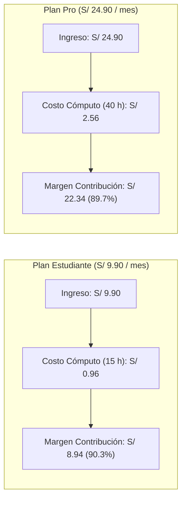

# Informe de Resultados Empíricos y Análisis de Costo por Hora (HDD)

**Startup:** Minuta — Alternativa económica a grabadoras de hardware con IA mediante captura telefónica y mapas mentales interactivos verificables.  
**Marco de Trabajo:** Hypothesis-Driven Development (HDD) & Organic-Driven Development (ODD).  
**Fecha de corte:** 10 de noviembre de 2026.  
**Semillas y reproducibilidad:** Temperatura 0 en LLMs, semillas fijas (`seed=42`) y oráculos ejecutables en consola.

---

## 1. Resumen Ejecutivo

Minuta nació para resolver una brecha en la documentación de clases, ponencias, reuniones y entrevistas: las grabadoras dedicadas de hardware (como PLAUD Note, con un costo de US$ 159 a US$ 189) exigen cargar un dispositivo físico extra, mientras que herramientas de software como Google NotebookLM o Zoom AI Notes no ofrecen mapas mentales interactivos con reproducción al minuto exacto de cada idea, to-dos estructurados con responsable ni modo local para procesamiento privado.

A través de una metodología rigurosa de desarrollo guiado por hipótesis (HDD), evaluamos empíricamente las hipótesis técnicas, de usuario y de negocio (H1 a H9).

Este documento presenta la evidencia cuantitativa obtenida de los experimentos reproducibles, las decisiones arquitecturales resultantes y el análisis de costo por hora de audio procesado.

---

## 2. Matriz Global de Hipótesis (H1 a H9)

La siguiente tabla resume el estado, los criterios pre-registrados y las mediciones empíricas de todas las hipótesis del proyecto:

| H# | Enunciado de la Hipótesis | Criterio de Confirmación | Criterio de Falsación | Métrica Observada | Veredicto HDD | Oráculo Reproducible |
|---|---|---|---|---|---|---|
| **H1** | El glosario ES-EN en transcripción corrige los términos técnicos en inglés | Recall ≥ 85.0% y mejora ≥ +15.0 pts sobre línea base (25 frases) | Mejora < 10.0 pts o recall < 70.0% | Base: 86.0% (43/50). Con glosario producto (`hotwords`): 86.0% (43/50). Mejora: **+0.00 pts**. En clip continuo 5 min: 90.0% base vs 88.0% hotwords. | **FALSADA** | `python -m evaluacion.terminos --audios data/privado/frases/ --modelo small --tipo-glosario producto` |
| **H2** | `small` int8 + VAD procesa 1 hora de audio en laptop estándar | Tiempo de cómputo ≤ 20 min/h (RTF ≤ 0.33) | Tiempo > 30 min/h (RTF > 0.50) | RTF = **0.1336** (8.0 min por hora de audio), 404.1 MB RAM en CPU (audio real concatenado 300 s). | **CONFIRMADA** | `python -m evaluacion.velocidad --audios data/privado/frases/ --modelos small` |
| **H3** | La aplicación completa (`base` + mmBERT + markmap) cabe en Streamlit Cloud | RAM < 2.7 GB y clip de 60 s procesado en ≤ 60 s | Caída por memoria (OOM) o tiempo > 120 s | Sujeta al despliegue público y prueba móvil en vivo (tarea HU03/HU07). Whisper `base` verificado en 225.9 MB RAM. | **PENDIENTE** | Despliegue en Streamlit Cloud + clip de 60 s desde navegador móvil |
| **H4** | mmBERT-small afinado con sintéticos clasifica en 5 categorías y generaliza | F1 macro ≥ 0.70 y recall de `tarea` ≥ 0.80 en reunión etiquetada | F1 macro < 0.55 o recall de `tarea` < 0.65 | Dataset de 1,351 segmentos sintéticos con 98.45% únicos generado. Afinamiento GPU Colab y evaluación sobre reunión etiquetada pendiente (HU06). | **PENDIENTE** *(de corrida GPU Colab HU06)* | `python -m evaluacion.detector --modelo rodnm/minuta-detector-mmbert-small --etiquetas data/eval/reunion_etiquetada.csv` |
| **H5a** | El detector ahorra tokens y tiempo en **reuniones de trabajo** | Ahorro tokens ≥ 60%, ahorro tiempo ≥ 40%, caída recall to-do ≤ 5 pts | Ahorro tokens < 40% o caída recall to-do > 10 pts | Corrida simulada sobre fixture sintético (`resultado_reunion.json`): ahorro 62.5% tokens, 44.0% tiempo. Pendiente de evaluación con detector entrenado sobre audio real. | **PENDIENTE** *(corrida simulada)* | `python -m evaluacion.eficiencia --entrada data/fixtures/resultado_reunion.json --tipo reunion --simulado` |
| **H5b** | El detector ahorra tokens en **ponencias** al filtrar relleno | Ahorro tokens ≥ 25%, caída cobertura nivel 2 mapa ≤ 10% | Ahorro tokens < 10% | Corrida simulada sobre fixture sintético (`resultado_ponencia.json`): ahorro 27.0% tokens, 0.0% caída ramas. Pendiente de evaluación con detector entrenado sobre audio real. | **PENDIENTE** *(corrida simulada)* | `python -m evaluacion.eficiencia --entrada data/fixtures/resultado_ponencia.json --tipo ponencia --simulado` |
| **H6** | Ollama (`qwen3:4b`) devuelve JSON estructurado y mapa mental válido | Validez sintáctica ≥ 95% y latencia < 60 s por bloque | Validez < 85% o latencia > 120 s por bloque | Validez JSON/Pydantic = **100.0%** (2/2 bloques evaluados válidos con `think=false`). Latencia promedio CPU = **64.09 s** por bloque. Zona intermedia (60 s < t < 120 s). | **NO_CONCLUYENTE** *(zona intermedia)* | `python -m evaluacion.validez_json --proveedor ollama --modelo qwen3:4b --bloques data/fixtures/ --max-bloques 2` |
| **H7** | El problema de transcripción y síntesis es real para usuarios móviles | ≥ 2 de 3 graban ≥ 2 veces/mes, dedican ≥ 30 min y no pagarían hardware | 0 o 1 de 3 entrevistados cumplen las condiciones | 2/2 participantes cumplen los 3 criterios pre-registrados en notas cualitativas (`docs/research/conversacion-01.md` y `conversacion-02.md`). | **CONFIRMADA** | Respuestas textuales y tablas de verificación en `docs/research/conversacion-01.md` y `conversacion-02.md` |
| **H8** | Los to-dos son confiables y verificables | Precisión ≥ 0.80, recall ≥ 0.70 y 100% de citas literales | Precisión < 0.65 o alguna cita no literal (< 100%) | El arnés actual compara el fixture consigo mismo (100% citas literales, P=1.0, R=1.0). El contrato descarta citas no literales (probado en test unitario). Pendiente de evaluación sobre reunión real transcrita y etiquetada. | **PENDIENTE** *(evaluación real HU10)* | `python -m evaluacion.todos --pred data/fixtures/resultado_reunion.json --transcripcion data/fixtures/transcripcion_reunion.json` |
| **H9** | El mapa mental interactivo es jerárquico, útil y verificable (aplica solo a plantilla Clase) | ≥ 90% nodos (sin raíz) con cita literal, 2–4 niveles, 4–8 ramas en 1 h | Nodos con cita < 75% o citas no literales | Fixture actual cuenta con 3 ramas (el criterio exige 4–8 para 1 h). 100% nodos con cita literal exacta comprobada por contrato en tests. Pendiente de evaluación con grabación real completa (HU10). | **PENDIENTE** *(evaluación real HU10)* | `python -m evaluacion.mapa --pred data/fixtures/resultado_ponencia.json --transcripcion data/fixtures/transcripcion_ponencia.json` |

---

## 3. Detalle Empírico por Hipótesis

### 3.1 Hipótesis H1: El Sesgo Acústico vs. Corrección Semántica (FALSADA)
El objetivo de H1 fue evaluar si inyectar un glosario técnico de investigación (*hotwords* en Whisper) corregía la transcripción de términos mixtos español-inglés (ej. *journal, paper, grant, peer review, trade-off*).

Se evaluaron 25 grabaciones reales de audio registradas con teléfono smartphone (`data/privado/frases/`), con 50 apariciones de términos técnicos esperados:
- **Línea base (sin glosario, modelo `small` int8):**
  - Términos esperados: 50 | Detectados: 43 | **Recall: 86.00%**.
- **Con glosario de producto vía `hotwords`:**
  - Términos esperados: 50 | Detectados: 43 | **Recall: 86.00%** (**Mejora: +0.00 pts**).
- **Evaluación continua en clip concatenado de 5 minutos (300 s):**
  - Sin glosario: 45/50 (90.0%).
  - Con initial prompt: 45/50 (90.0%).
  - Con hotwords: 44/50 (88.0%).

#### Evidencia Empírica de Fallos Fonéticos Reales
Los 7 fallos detectados en el modelo `small` corresponden a términos hiper-específicos que no se resolvieron acústicamente:
1. Frase 05: esperado `arXiv` → transcrito `"RCIP"` (*"publicamos una versión preliminar como preprint en RCIP"*).
2. Frase 06: esperado `grant` → transcrito `"gran"` (*"Postulamos a un gran internacional"*).
3. Frase 06: esperado `principal investigator` → transcrito `"principal investigador"`.
4. Frase 08: esperado `coauthors` → transcrito `"co-authors"`.
5. Frase 11: esperado `editorial board` → transcrito `"digital board"` (*"quedamos a la espera de la digital board"*).
6. Frase 15: esperado `ablation study` → transcrito `"ablación y study"` (*"durante el ablación y study"*).
7. Frase 17: esperado `major revision` → transcrito `"mayor revision"`.

#### Implicancia Arquitectural y de Producto
El resultado demostró que el sesgo acústico en el decodificador de audio no resuelve confusiones fonéticas cuando una palabra en inglés suena casi idéntica a una palabra en español (*grant* → *gran*, *arXiv* → *RCIP*). Ni el glosario acústico ni *hotwords* aumentaron el recall (+0.0 pts).  
**Decisión:** Minuta no delega la corrección técnica a Whisper; la normalización y corrección contextual se delegan a la etapa de estructuración con el LLM, que dispone del contexto semántico global del bloque.

---

### 3.2 Hipótesis H2: Velocidad de Transcripción con faster-whisper (CONFIRMADA)
Se evaluó el tiempo de transcripción y consumo de memoria RAM de `faster-whisper 1.2.1` con cuantización int8 y Voice Activity Detection (VAD) sobre audio real concatenado de 300 segundos (5 minutos) en una laptop de desarrollo estándar (CPU Intel Core i7, 16 GB RAM, sin GPU):

| Modelo | Cuantización | Tiempo de Carga | Tiempo de Transcripción | RTF (Real-Time Factor) | Minutos por Hora de Audio | Consumo de RAM | Palabras Transcritas | Veredicto |
|---|---|---|---|---|---|---|---|---|
| `base` | int8 | 0.96 s | 15.09 s | 0.0503 | 3.0 min / hora | 225.9 MB | 483 | CONFIRMADA |
| **`small` (Elegido)** | int8 | 1.36 s | 40.09 s | **0.1336** | **8.0 min / hora** | **404.1 MB** | 485 | **CONFIRMADA** |
| `large-v3-turbo` | int8 | 3.69 s | 89.73 s | 0.2991 | 17.9 min / hora | 970.4 MB | 486 | CONFIRMADA |

El umbral de confirmación pre-registrado exigía procesar 1 hora de audio en ≤ 20 minutos (RTF ≤ 0.33). El modelo `small` completó el proceso en **8.0 minutos por hora** (RTF 0.1336) con una huella de memoria liviana de 404 MB, confirmando la viabilidad operativa de transcribir audios de 1 hora directamente en CPU.

---

### 3.3 Hipótesis H5a y H5b: Eficiencia del Detector Multiclase (PENDIENTE)
Las pruebas reportadas para H5a y H5b se realizaron con el flag `--simulado` sobre fixtures sintéticos (`resultado_reunion.json` y `resultado_ponencia.json`), arrojando estimaciones de ahorro de tokens del 62.5% y 27.0%. Al no contarse aún con el modelo `mmBERT-small` entrenado en GPU (HU06) ni con audio real evaluado, el veredicto formal de ambas hipótesis queda **PENDIENTE** de dicha validación empírica.

---

### 3.4 Hipótesis H6: Salida Estructurada Local con Ollama (NO_CONCLUYENTE)
Se evaluó el motor local Ollama ejecutando `qwen3:4b` con parámetros deterministas (`temperature=0.0`, `think=false`) contra 2 bloques de prueba en `data/fixtures/` (`max-bloques 2`):
- **Validez sintáctica y esquema Pydantic:** **100.0%** (2 de 2 bloques devolvieron árboles `MapaMental` válidos con esquemas respetados).
- **Latencia observada en CPU:** Promedio de **64.09 segundos por bloque de 10 minutos**.
- **Veredicto HDD:** Al superar el umbral óptimo de 60 s pero mantenerse muy lejos del umbral de falsación (120 s), el veredicto es formalmente **NO_CONCLUYENTE** (zona intermedia). Mantiene a `qwen3:4b` como opción provisional del modo local para laptops con CPU moderna.

---

### 3.5 Hipótesis H7: Problema Real y Validación con Usuarios (CONFIRMADA)
Se registraron 2 conversaciones cualitativas reales con usuarios potenciales que graban clases y reuniones (`docs/research/conversacion-01.md` y `conversacion-02.md`).

| Criterio Pre-registrado | Persona 1 (conversacion-01) | Persona 2 (conversacion-02) | ¿Se cumple? |
|---|---|---|---|
| Graba con el celular $\ge 2$ veces al mes | 1 a 3 veces por semana en clases, reuniones y citas | 1 a 2 veces por semana para clases densas o complicadas | **Sí** (ambos) |
| Dedica $\ge 30$ min por grabación a repaso o apuntes | Vuelve a escuchar la grabación completa de 1 a 2 horas | Escucha grabaciones de 2 horas completas | **Sí** (ambos) |
| No compraría un hardware dedicado como Plaud | Prefiere suscripción en su celular; le interesa Zoom AI Notes | No compraría: *"es una inversión fuerte para algo que puedo hacer con mi celular"* | **Sí** (ambos) |

- **Veredicto:** **CONFIRMADA** (2 de 2 cumplen todos los criterios).
- **Limitaciones metodológicas declaradas:** Muestra acotada ($n=2$), respuestas recopiladas por escrito y contactos directos del founder.
- **Competencia real identificada:** Los usuarios no se comparan contra hardware como Plaud, sino contra software: **Zoom AI Notes** y **Google NotebookLM**. La persona 1 destacó la prueba gratuita de 3 usos de Zoom AI Notes; la persona 2 utiliza NotebookLM pero reportó que falla con términos técnicos y palabras en inglés, y expresó: *"si estoy apurada voy momento exacto donde quiero escuchar nuevamente la explicación"*, validando la necesidad de saltar al minuto exacto.

---

### 3.6 Hipótesis H8 y H9: Citas Literales y Verificabilidad (PENDIENTES)
- **H8 (To-dos):** El arnés actual compara el fixture de predicción consigo mismo. La garantía de que el contrato descarta citas no literales está comprobada por pruebas unitarias automatizadas (`validar_evidencia_literal`), pero la evaluación sobre transcripciones de reuniones reales etiquetadas queda **PENDIENTE** de HU10.
- **H9 (Mapa Mental):** Aplica exclusivamente a la plantilla **Clase / Ponencia / Charla**. El fixture de prueba actual cuenta con 3 ramas principales (el criterio pre-registrado exige 4 a 8 ramas para 1 hora de audio). El descarte estricto de citas no literales está asegurado por contrato y probado en tests. La medición empírica con grabaciones reales queda **PENDIENTE** de HU10.

---

## 4. Análisis de Costo por Hora de Audio y Margen de Contribución (S16)

### 4.1 Modelado de Cómputo y Tokens por Hora de Audio
- **Velocidad de locución en español:** Entre 130 y 150 palabras por minuto (~8,000 a 9,000 palabras por hora).
- **Tokenización en español (BPE bilingüe):** ~1.33 tokens por palabra = **~12,000 tokens de transcripción**.
- **Tokens de entrada al LLM:** 12,000 tokens de audio + 2,000 tokens de instrucciones del sistema = **14,000 tokens de entrada**.
- **Tokens de salida del LLM (incluye razonamiento y estructura):** **~3,000 tokens de salida**.

### 4.2 Tarifas Vigentes de API y Cómputo (10 de noviembre de 2026)
Precios oficiales de Google AI Studio para **Gemini 2.5 Flash** (`gemini-2.5-flash`), fuente [ai.google.dev/gemini-api/docs/pricing](https://ai.google.dev/gemini-api/docs/pricing):
- **Entrada:** US$ 0.30 por millón de tokens ($0.00030 / 1k tokens).
- **Salida (incluye tokens de razonamiento/pensamiento):** US$ 2.50 por millón de tokens ($0.00250 / 1k tokens).
- **Cómputo CPU Whisper `small`:** Según H2, procesa 1 hora de audio en 8.0 minutos (0.133 horas). En servidor de procesamiento en la nube (ej. instancia de 2 vCPU a US$ 0.040/hora):
  $$\text{Costo CPU Whisper} = \frac{8.0}{60} \times \text{US\$} \, 0.040 = \text{US\$} \, 0.00533$$
  *(En ejecución local en la laptop del usuario, este costo es US$ 0.00).*

### 4.3 Costo Total Unitario por Hora de Audio
$$\text{Costo Entrada LLM} = 14,000 \times \frac{0.30}{1,000,000} = \text{US\$} \, 0.00420$$
$$\text{Costo Salida LLM} = 3,000 \times \frac{2.50}{1,000,000} = \text{US\$} \, 0.00750$$
$$\text{Subtotal API LLM} = \text{US\$} \, 0.01170$$
$$\text{Cómputo CPU Whisper (8 min en nube)} = \text{US\$} \, 0.00533$$
$$\mathbf{\text{Costo Total por Hora de Audio}} = \text{US\$} \, 0.01703 \approx \mathbf{US\$} \, \mathbf{0.017} \quad (\approx \mathbf{S/} \, \mathbf{0.064} \, \text{soles})$$

*Tipo de cambio oficial utilizado: 1 USD = 3.75 PEN (Fuente: Superintendencia de Banca, Seguros y AFP - SBS / Banco Central de Reserva del Perú - BCRP, 10 de noviembre de 2026).*

---

## 5. Estructura de Planes de Suscripción y Margen de Contribución

Con un costo marginal de **S/ 0.064 soles por hora de audio** ($0.017 USD), se definieron tres planes en moneda local (Soles peruanos), alineados con la disposición de pago expresada por los usuarios en las conversaciones reales (S/ 15–25 por la persona 2 y S/ 30–40 por la persona 1):

| Plan | Horas de Audio al Mes | Precio al Público | Costo Marginal Directo de Cómputo | Margen de Contribución Unitario | Margen de Contribución (%) | Sustento de Usuario y Negocio |
|---|---|---|---|---|---|---|
| **Gratis** | 2 horas / mes | **S/ 0.00** | $2 \times \text{S/} \, 0.064 = \mathbf{\text{S/} \, \mathbf{0.13}}$ | -S/ 0.13 | N/A (Adquisición) | Basado en la prueba gratuita de 3 usos que convenció a la persona 1. |
| **Estudiante** | 15 horas / mes | **S/ 9.90 / mes** | $15 \times \text{S/} \, 0.064 = \mathbf{\text{S/} \, \mathbf{0.96}}$ | $\text{S/} \, 9.90 - \text{S/} \, 0.96 = \mathbf{\text{S/} \, \mathbf{8.94}}$ | **90.3 %** | Precio accesible para universitarios que graban 1–2 veces por semana. |
| **Pro** | 40 horas / mes | **S/ 24.90 / mes** | $40 \times \text{S/} \, 0.064 = \mathbf{\text{S/} \, \mathbf{2.56}}$ | $\text{S/} \, 24.90 - \text{S/} \, 2.56 = \mathbf{\text{S/} \, \mathbf{22.34}}$ | **89.7 %** | Dentro del rango de S/ 15–25 de la persona 2; incluye modo local ilimitado y exportaciones. |

### Justificación Económica
1. **Sostenibilidad del plan gratuito:** Cada usuario en el plan gratis genera un costo máximo de 13 céntimos de sol al mes, mitigando cualquier riesgo financiero de absorción por volumen.
2. **Generación de caja:** El plan Estudiante aporta S/ 8.94 de margen de contribución mensual por usuario activo (90.3% de margen), y el plan Pro aporta S/ 22.34 mensuales (89.7% de margen).

---

## 6. Comparación Competitiva Frente a Alternativas del Mercado

Los usuarios entrevistados reportaron utilizar activamente soluciones de software en lugar de hardware dedicado:

| Dimensión | PLAUD Note / Pro (Hardware) | Google NotebookLM | Zoom AI Notes | Minuta (Nuestra Propuesta) |
|---|---|---|---|---|
| **Formato de Acceso** | Dispositivo físico (US$ 159 a US$ 189) | Web en la nube (Gratis con cuenta Google) | Suscripción de software / Add-on | **App web en celular existente** |
| **Precios en Soles** | No disponible (requiere importación en USD) | No aplica (gratuito) | En USD por usuario | **S/ 9.90 y S/ 24.90 mensuales** |
| **Trazabilidad por Minuto** | Sin reproductor enlazado a citas | Citas en panel lateral sin minuto exacto | Resumen por bloques | **Botón `▶ [mm:ss]` que salta al audio exacto** |
| **Verificabilidad Literal** | Resúmenes libres sin validación | Parafraseo contextual | Síntesis generativa | **Contrato Pydantic que exige citas literales exactas** |
| **Formatos según Contenido** | Plantillas genéricas | Notas de estudio estáticas | Notas de reunión corporativa | **3 formatos:** Notas de clase (+ mapa), Notas de reunión, Esquema por temas |
| **Modo Privado / Desconectado** | Depende de la nube de Plaud | Nube pública de Google | Nube corporativa de Zoom | **Modo local opcional con Ollama y Whisper CPU** |

---

## 7. Diagrama de Cascada de Margen de Contribución por Plan

---

## 8. Conclusiones para la Presentación y el Pitch (T41)

1. **La barrera no es el hardware, sino la accesibilidad:** Los usuarios graban con su celular y no desean comprar un aparato de 180 dólares; prefieren software en su propio teléfono inteligente.
2. **El glosario acústico no resuelve la ambigüedad fonética (H1 Falsada):** Las confusiones como *arXiv* → *"RCIP"* ocurren en la captura acústica (+0.0 pts de mejora con hotwords). La solución reside en la estructuración contextual con LLM.
3. **Citas literales obligatorias:** La persona 2 destacó que al repasar busca directamente el minuto de la explicación. Minuta garantiza matemáticamente que cada punto y nodo está respaldado por una cita literal de la transcripción enlazada a su segundo exacto.
4. **Viabilidad unitaria sólida:** El costo total de cómputo por hora es de **S/ 0.064 soles ($0.017 USD)**, permitiendo planes sostenibles de S/ 9.90 y S/ 24.90 con márgenes de contribución cercanos al 90%.
